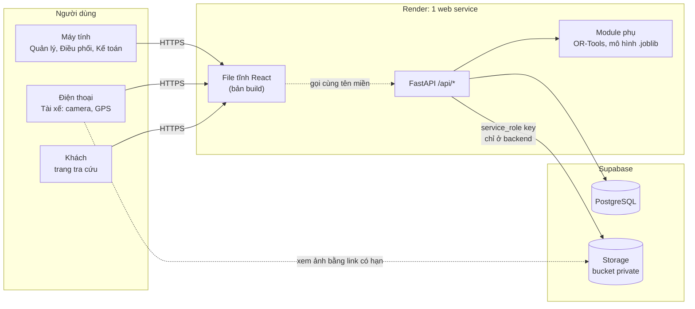
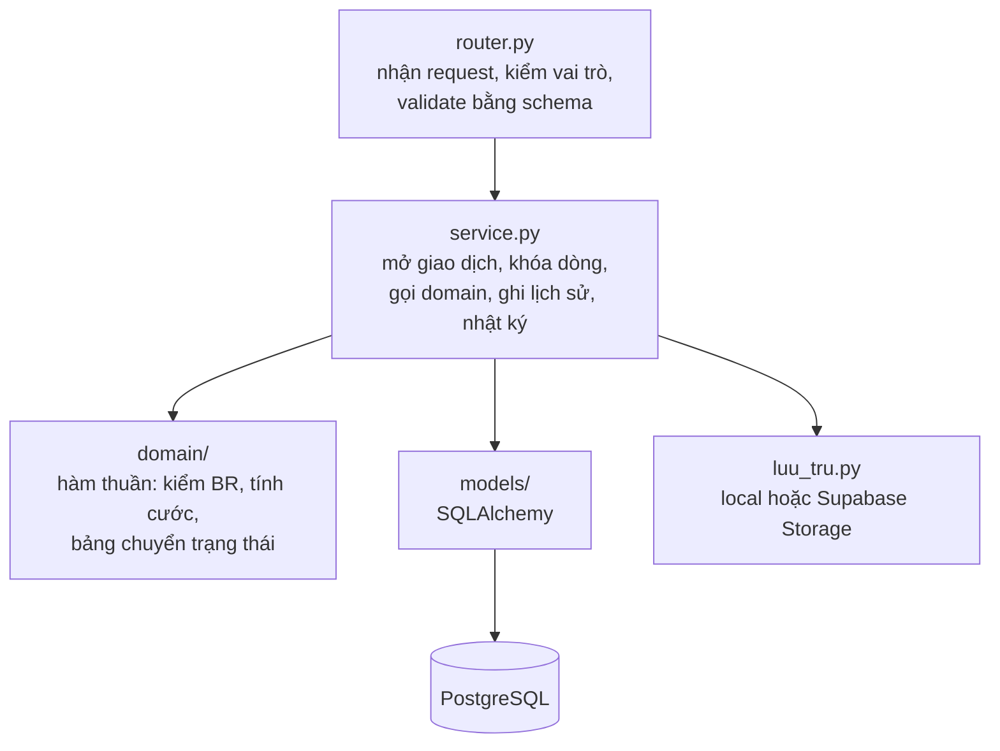

# Kiến trúc hệ thống

> Phiên bản 0.2 · 15/10/2026 · Nhóm 10 (cập nhật theo nghiệp vụ 0.5). Khớp `docs/nghiep-vu.md` (mục 8 Nền tảng và triển khai), `docs/so-do.md` (ERD, sequence), `docs/security-rules.md`.
> Đặc tả endpoint: `docs/api.md`. Code lệch tài liệu này thì sửa tài liệu trong cùng commit.

---

## 1. Tóm tắt quyết định

| Mã | Quyết định | Lý do | Phương án đã bỏ |
|---|---|---|---|
| KT-01 | **Một khối (monolith) chia module theo phân hệ**, một backend FastAPI | 2 người, 10 tuần. Nghiệp vụ ghép đơn cần giao dịch chung trên Chuyến, Đơn, Ghép | Microservice: thêm mạng, thêm triển khai, không có lợi ở quy mô này |
| KT-02 | **FastAPI phục vụ luôn bản build React** trên cùng tên miền | Một service trên Render, không phải cấu hình CORS, cookie đăng nhập dùng được `SameSite=Strict` | Host frontend riêng (Vercel, Netlify): thêm một nơi triển khai |
| KT-03 | **3 lớp trong backend**: router → service → domain; model SQLAlchemy dùng chung | Quy tắc nghiệp vụ nằm ở domain/service (NFR-MAI-01), domain không chạm DB nên unit test nhanh | Thêm lớp repository: YAGNI, SQLAlchemy đã đủ trừu tượng |
| KT-04 | **PostgreSQL** cho cả dev (docker) và demo (Supabase) | Cần unique index một phần (BR-07) và `SELECT … FOR UPDATE` (ghép đơn, quyết toán) | SQLite: không có `FOR UPDATE`, khác DB thật |
| KT-05 | **Đăng nhập bằng JWT trong cookie httpOnly** | JavaScript không đọc được token nên bị XSS cũng khó lấy token | Token trong localStorage: lộ khi bị XSS |
| KT-06 | **Kiểu TypeScript sinh từ OpenAPI của FastAPI** | Mã trạng thái và mã lỗi chỉ khai báo một lần ở backend (DRY), frontend gõ sai thì báo lỗi lúc build | Viết tay kiểu ở frontend: dễ lệch |
| KT-07 | **Lưu file qua một lớp `LuuTru`**: dev ghi thư mục local, demo ghi Supabase Storage bucket private | Ổ đĩa Render không giữ file; đổi nơi lưu không đụng nghiệp vụ | Lưu ảnh trong DB: phình DB 500 MB |
| KT-08 | **Module phụ (UC-30) chạy chung process**, gọi qua service riêng, lỗi thì trả "không có gợi ý" | KISS; mô hình train sẵn, chỉ nạp file khi chạy | Service AI riêng: thêm triển khai |

Thư viện cụ thể (đọc QR, nén ảnh, sinh kiểu từ OpenAPI…) chọn khi làm story tương ứng, **hỏi trước khi cài** (CLAUDE.md) và kiểm tra bảo mật như với skill.

---

## 2. Sơ đồ triển khai



Lúc phát triển: `docker compose` chạy PostgreSQL; backend và frontend chạy trên máy; ảnh ghi vào thư mục `backend/uploads/` (đã `.gitignore`). Thử camera trên điện thoại qua Cloudflare Quick Tunnel.

---

## 3. Phân lớp backend



| Lớp | Được làm | Không được làm |
|---|---|---|
| `router` | Đọc request, `Depends(can_vai_tro(...))`, gọi **một** hàm service, trả schema | Chứa quy tắc nghiệp vụ, truy vấn DB trực tiếp |
| `service` | Giao dịch, `FOR UPDATE`, kiểm quyền sở hữu (tài xế chỉ chuyến của mình), gọi domain, ghi `LICH_SU_TRANG_THAI` và `NHAT_KY_TIEN` | Đọc request/response HTTP |
| `domain` | Hàm thuần nhận dữ liệu, trả kết quả hoặc danh sách vi phạm. Mỗi BR là một hàm có tên chứa mã, ví dụ `kiem_br01_tai_trong()` | Import SQLAlchemy, gọi mạng, đọc giờ hệ thống (giờ truyền vào làm tham số để test được) |

**Chuyển trạng thái chỉ đi qua một chỗ:** `domain/trang_thai.py` chứa hai bảng chuyển (Chuyến, Đơn) chép đúng mục 5 của `nghiep-vu.md`. Service gọi `chuyen_trang_thai(doi_tuong, sang, nguoi, ly_do)`: kiểm cặp (từ, sang) có trong bảng, đổi trạng thái, ghi lịch sử (BR-30). Không có chỗ nào khác được gán thẳng `trang_thai`.

---

## 4. Cấu trúc thư mục

```
QLVC/
├─ docs/                      tài liệu (nguồn sự thật)
├─ backend/
│  ├─ app/
│  │  ├─ main.py              tạo app, gắn router, phục vụ frontend/dist
│  │  ├─ config.py            đọc biến môi trường (không có giá trị mặc định thật)
│  │  ├─ db.py                engine, session, giao dịch
│  │  ├─ loi.py               lỗi nghiệp vụ chung: LoiNghiepVu(ma, thong_diep, chi_tiet)
│  │  ├─ auth/                đăng nhập, JWT cookie, can_vai_tro()
│  │  ├─ models/              bảng SQLAlchemy theo ERD
│  │  ├─ domain/              trang_thai.py, cuoc.py, ghep.py, xe_tai_xe.py, quet.py, tien.py
│  │  ├─ luu_tru.py           LuuTruLocal, LuuTruSupabase
│  │  └─ modules/             một thư mục mỗi phân hệ: router.py, service.py, schemas.py
│  │     ├─ danh_muc/         người dùng, xe, tài xế, nút, tuyến, khách, bảng giá, cấu hình
│  │     ├─ don/
│  │     ├─ chuyen/           lập, ghép, chốt, theo dõi, sự cố (UC-11…16, 32)
│  │     ├─ quet/             bắt đầu/kết thúc, quét, báo sự cố (UC-17…20, 33)
│  │     ├─ tien/             chi phí, tạm ứng, quyết toán, công nợ, báo cáo, hiệu suất xe
│  │     ├─ tra_cuu/
│  │     └─ goi_y/            UC-30 dự đoán trễ
│  ├─ alembic/                migration
│  ├─ seed/                   dữ liệu mẫu (vài trăm đơn) và script sinh 10.000 đơn để test hiệu năng
│  └─ tests/
│     ├─ unit/                test domain, không cần DB
│     └─ api/                 test API với PostgreSQL thật (docker)
├─ frontend/
│  └─ src/
│     ├─ api/                 client + kiểu sinh từ OpenAPI (không sửa tay)
│     ├─ pages/               dieu-phoi/, ke-toan/, quan-ly/, tai-xe/, tra-cuu/
│     ├─ components/
│     └─ lib/                 nén ảnh, quét QR, định dạng tiền và giờ
├─ ml/                        notebook train mô hình UC-30, xuất file .joblib
├─ docker-compose.yml
└─ .env.example               chỉ tên biến, không có giá trị
```

---

## 5. Xác thực và phân quyền

- Đăng nhập: `POST /api/auth/dang-nhap` → backend đặt cookie `access_token` (JWT) với `HttpOnly`, `Secure`, `SameSite=Strict`, hết hạn ≤ 8 giờ (NFR-SEC-01). Mật khẩu băm bằng argon2 hoặc bcrypt.
- Mỗi router khai báo vai trò được gọi bằng `Depends(can_vai_tro("DIEU_PHOI", "QUAN_LY"))` (BR-57). Sai vai trò → 403.
- **Quản lý kế thừa quyền Điều phối** (ma trận mục 6 của `nghiep-vu.md`): `can_vai_tro` tự cho `QUAN_LY` qua khi danh sách có `DIEU_PHOI`.
- Quyền sở hữu kiểm trong service, không chỉ ở router: tài xế chỉ thao tác chuyến có `tai_xe_id` là mình (BR-58, chống IDOR). Không phải của mình → 403, khớp sơ đồ 9 (BR-38).
- Khách không đăng nhập; trang tra cứu giới hạn tần suất theo IP (NFR-SEC-05).
- Giới hạn tần suất đăng nhập: khóa tạm sau nhiều lần sai (NFR-SEC-05).

---

## 6. Giao dịch và đồng thời

| Thao tác | Khóa | Ràng buộc ở DB |
|---|---|---|
| Ghép, gỡ đơn (UC-13) | `FOR UPDATE` dòng chuyến, các dòng đơn, dòng xe, dòng tài xế (BR-67 kiểm lại khoảng chiếm với chuyến khác của xe, tài xế) | Unique index một phần `GHEP(don_hang_id) WHERE hieu_luc` (BR-07) |
| Lập chuyến (UC-11), đổi xe, tài xế (UC-12), chốt, mở chốt (UC-15) | `FOR UPDATE` dòng chuyến, dòng xe, dòng tài xế | — |
| Bắt đầu chuyến (UC-18) | `FOR UPDATE` dòng chuyến, dòng xe (km BR-70) | — |
| Quét mã (UC-19, UC-20) | `FOR SHARE` dòng chuyến, rồi `FOR UPDATE` dòng đơn. Kết thúc chuyến (`FOR UPDATE` dòng chuyến) phải đợi các lượt quét đang chạy | Quét lặp trả trạng thái hiện tại (BR-45) |
| Kết thúc chuyến (UC-18), kết thúc do sự cố (UC-32, BR-68) | `FOR UPDATE` dòng chuyến (đợi lượt quét đang chạy), rồi các dòng đơn, dòng xe (cập nhật `km_dong_ho`) | — |
| Tạm ứng (UC-23), quyết toán (UC-24) | `FOR UPDATE` dòng chuyến | Unique `QUYET_TOAN(chuyen_id)` |

Mọi thao tác ghi chạy trong **một giao dịch**; lỗi ở bất kỳ bước nào thì rollback toàn bộ (NFR-REL-01). Thứ tự khóa luôn là chuyến → đơn → xe → tài xế để tránh deadlock.

---

## 7. Lỗi và mã HTTP

Mọi lỗi trả cùng một dạng:

```json
{ "ma": "BR-01", "thong_diep": "Vượt tải trọng xe", "chi_tiet": [ { "don": "DH-0012", "vuot": "350 kg" } ] }
```

| HTTP | Khi nào |
|---|---|
| 400 | Dữ liệu sai kiểu, thiếu trường. FastAPI mặc định trả 422 cho lỗi này, nên `main.py` đăng ký handler chuyển `RequestValidationError` sang 400 (giữ 422 riêng cho vi phạm BR) |
| 401 | Chưa đăng nhập, token hết hạn |
| 403 | Sai vai trò, hoặc đúng vai trò nhưng không phải chủ sở hữu (tài xế khác chuyến). Chuyến của chính mình nhưng sai trạng thái là 409, không phải 403 |
| 404 | Không tồn tại |
| 409 | Sai trạng thái hoặc xung đột đồng thời (đơn vừa bị ghép nơi khác, chuyến không ở `HOAN_THANH`…) |
| 413 | File vượt giới hạn (NFR-PER-03) |
| 422 | Vi phạm quy tắc nghiệp vụ; `chi_tiet` liệt kê **mọi** vi phạm, mỗi mục có mã BR |
| 429 | Vượt giới hạn tần suất |

Giao diện hiển thị `ma` kèm câu tiếng Việt (NFR-USA-02).

---

## 8. Thời gian, tiền, số

- Lưu thời gian kiểu `timestamptz` (UTC). Hiển thị và tính "một ngày" của BR-18 theo giờ `Asia/Ho_Chi_Minh`.
- Giờ quét, giờ chuyển trạng thái lấy từ server, không nhận từ client.
- Tiền: `bigint` đồng (NFR-FUN-02). Kg, m³: `numeric`. Không dùng float.

---

## 9. Lưu file (ảnh, chữ ký)

1. Trình duyệt nén ảnh trước khi gửi (NFR-PER-03).
2. Backend kiểm loại file theo nội dung (JPEG, PNG) và kích thước, sinh tên `uuid`, không dùng tên người dùng gửi.
3. `LuuTru.luu()` ghi vào bucket private. DB chỉ lưu đường dẫn trong bảng `TEP`.
4. Xem ảnh: `GET /api/tep/{id}/link` kiểm quyền rồi trả link có hạn 5 phút (NFR-SEC-04).

---

## 10. Module phụ (làm sau cùng)

- UC-29 gợi ý ghép đơn (OR-Tools): bỏ ở nghiệp vụ 0.5, chuyển sang hướng phát triển. Thứ tự điểm dừng do lõi tự suy ra (BR-63).
- UC-30 dự đoán trễ: train trong `ml/`, xuất file mô hình, backend nạp lúc khởi động. Dataset cần kiểm tra giấy phép trước khi dùng.
- Module phụ lỗi, quá thời gian, hoặc chưa có mô hình → trả "chưa có gợi ý", lõi chạy bình thường.

---

## 11. Biến môi trường

Chỉ khai tên trong `.env.example`; giá trị thật đặt ở `.env` (máy dev) và Environment của Render.

| Tên | Dùng cho |
|---|---|
| `APP_ENV` | `dev` hoặc `demo` |
| `DATABASE_URL` | Chuỗi kết nối PostgreSQL |
| `JWT_SECRET` | Ký token; chuỗi ngẫu nhiên dài, khác nhau giữa dev và demo |
| `LUU_TRU` | `local` hoặc `supabase` |
| `SUPABASE_URL`, `SUPABASE_SERVICE_ROLE_KEY`, `SUPABASE_BUCKET` | Lưu file ở demo; khóa chỉ backend dùng |
| `POSTGRES_USER`, `POSTGRES_PASSWORD`, `POSTGRES_DB` | PostgreSQL trong `docker-compose.yml` lúc dev |

---

## 12. Kiểm thử và CI

| Mức | Công cụ | Chạy ở đâu |
|---|---|---|
| Unit (domain) | pytest | CI, mọi push |
| API (tích hợp) | pytest + client test của FastAPI + PostgreSQL trong CI | CI, mọi push |
| E2E luồng chính | `webapp-testing` (Playwright) | Máy dev, trước khi đóng story |
| Hiệu năng | Locust hoặc k6 với 10.000 đơn | Máy dev, tuần 9 |

GitHub Actions khi push (`.github/workflows/ci.yml`): backend `ruff check`, `ruff format --check`, pytest; frontend oxlint (lint đi kèm bản mẫu Vite), prettier, `tsc -b` + build; quét bí mật bằng binary gitleaks ghim phiên bản và checksum. Action bên ngoài ghim theo commit SHA. Phiên bản package ghim chính xác: `backend/requirements*.txt` dùng `==`, frontend commit `package-lock.json` và CI chạy `npm ci`. Mỗi use case làm theo `story-flow`.
