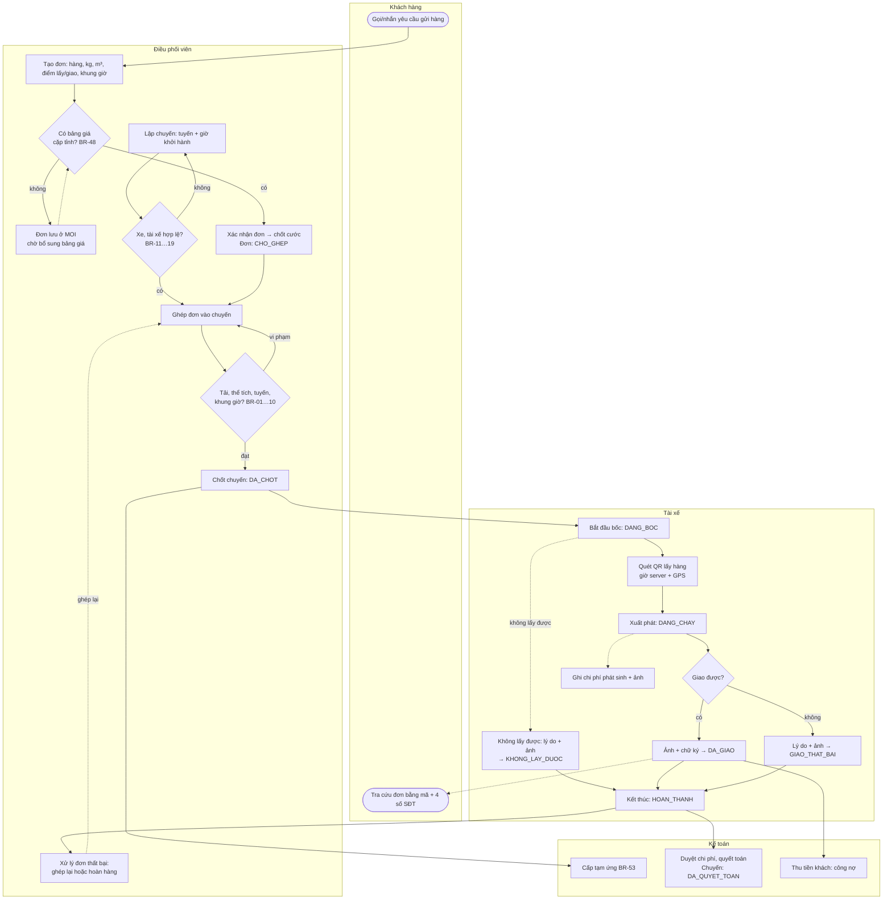
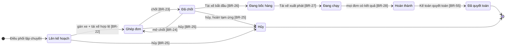
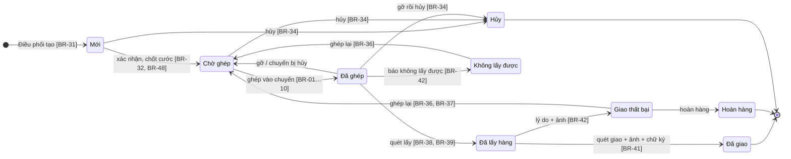
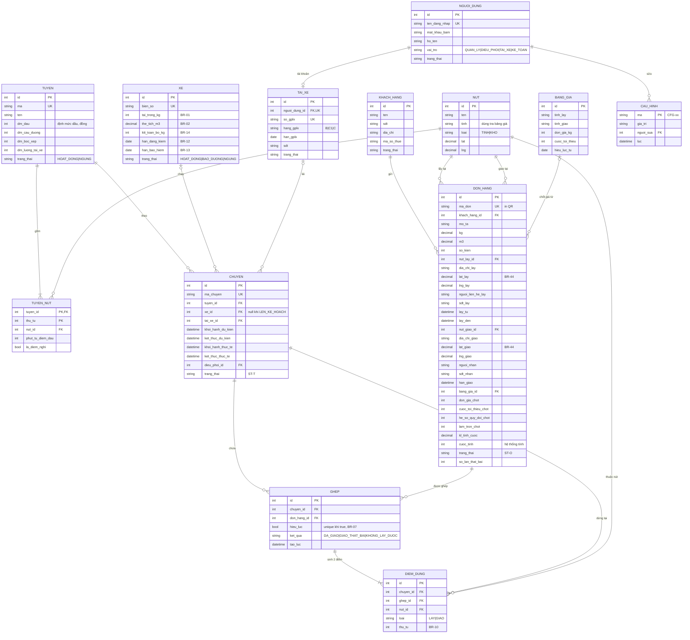
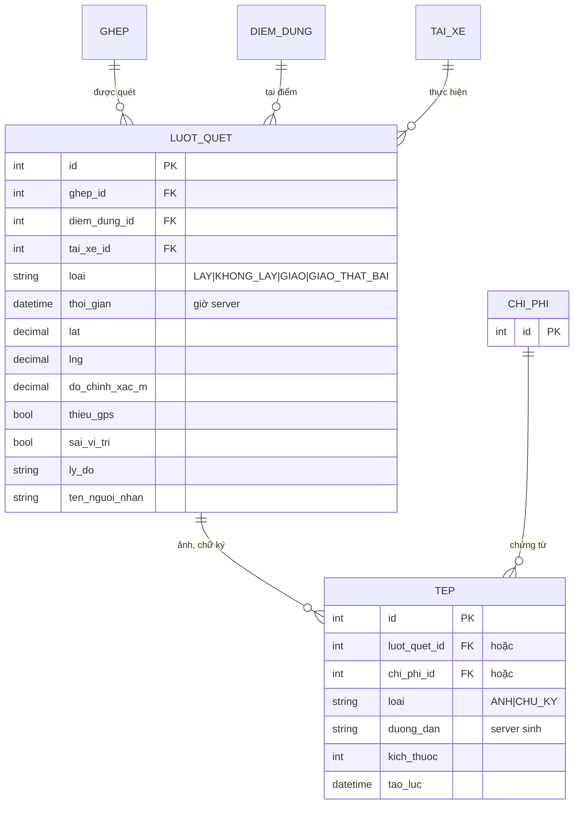
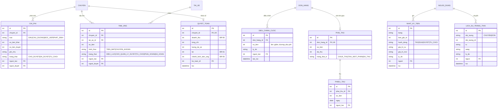
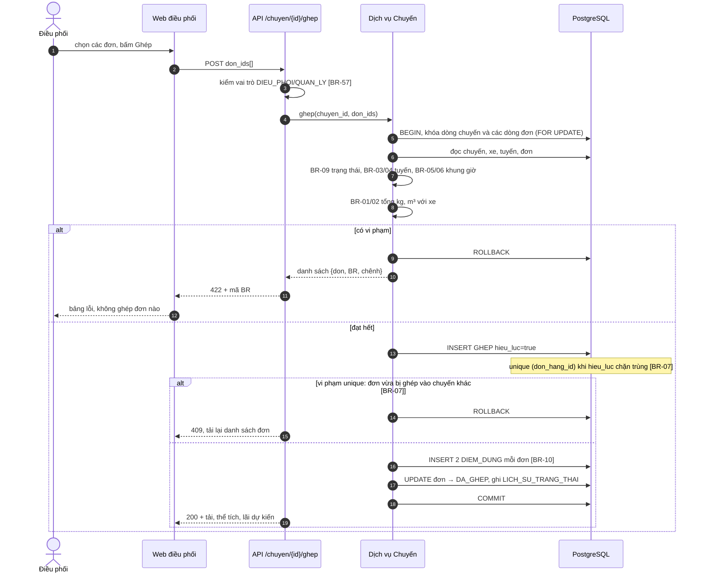
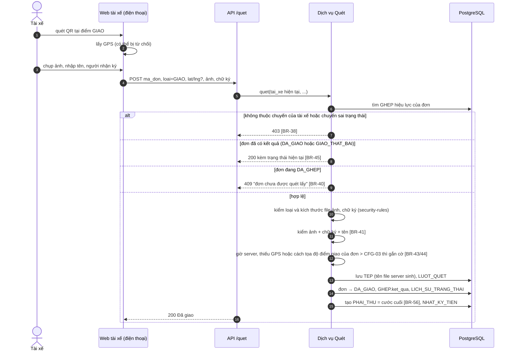
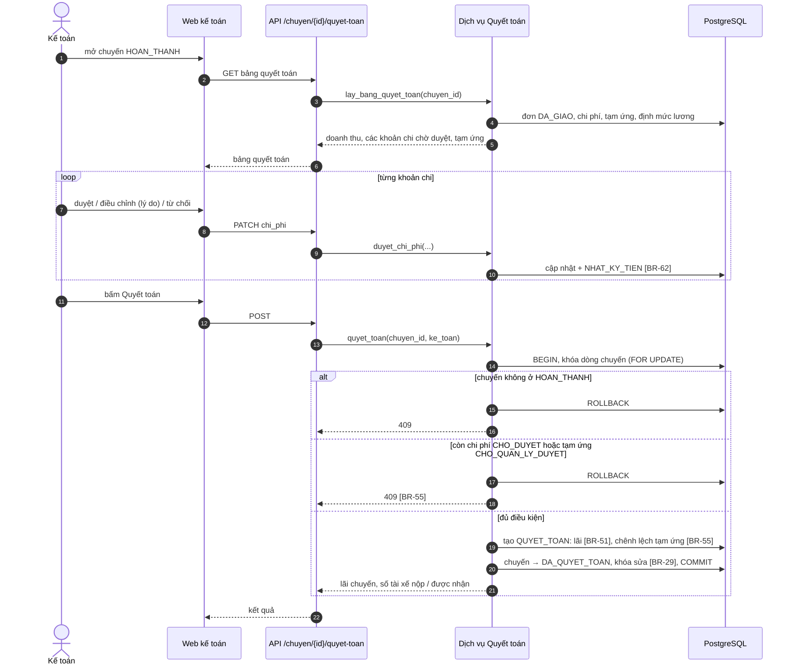

# Sơ đồ nghiệp vụ và dữ liệu

> Phiên bản 0.4 · 10/10/2026 · Nhóm 10. Khớp `docs/nghiep-vu.md` (BR-01…62) và `docs/use-cases.md` (UC-01…31).
> Viết bằng Mermaid: GitHub và VS Code (extension Markdown Preview Mermaid) hiển thị trực tiếp. Sửa nghiệp vụ thì sửa sơ đồ trong cùng commit.
> ERD là bản logic để hiểu nghiệp vụ; kiểu dữ liệu và index chi tiết chốt ở bước thiết kế CSDL.

## 1. Bức tranh nghiệp vụ

Liên quan: BR-01…62

Một vòng đời đầy đủ: đơn đi vào, được ghép lên chuyến, chạy, giao, rồi tiền được quyết toán. Mỗi làn là một tác nhân.

- Đọc từ trên xuống. Mũi tên chéo giữa các làn là lúc việc chuyển từ người này sang người khác.
- Ô thoi là chỗ hệ thống kiểm quy tắc nghiệp vụ; nhánh sai là thao tác bị chặn.
- Đơn thất bại không chết: nó quay về hàng chờ ghép (tối đa CFG-04 lần) hoặc hoàn hàng.

## 2. Sơ đồ use case

Liên quan: UC-01…31

Ai làm được gì. Use case gom theo phân hệ, khớp cột Phân hệ trong bảng mục 2 của use-cases.md.

- Mermaid không có ký hiệu use case chuẩn UML; báo cáo nên vẽ lại bằng draw.io hoặc StarUML theo đúng sơ đồ này.
- UC-01 Đăng nhập dùng chung cho mọi tác nhân trừ Khách, nên không vẽ đường để đỡ rối.
- UC-29, UC-30 là module phụ, nét đứt: chỉ gợi ý, không quyết định.
- Quản lý làm được mọi việc của Điều phối (ma trận phân quyền mục 6 của nghiep-vu.md). Khi vẽ lại bằng UML, dùng quan hệ tổng quát hóa Quản lý → Điều phối thay vì nối lại từng use case.

```mermaid
flowchart LR
  QL(("Quản lý"))
  DP(("Điều phối viên"))
  TX(("Tài xế"))
  KT(("Kế toán"))
  KH(("Khách hàng"))
  HT(("Hệ thống<br/>hằng ngày"))
  subgraph CHUNG["Chung"]
    UC02(["UC-02 Người dùng, vai trò"])
  end
  subgraph XTX["Xe / Tài xế"]
    UC03(["UC-03 Quản lý xe"])
    UC04(["UC-04 Quản lý tài xế"])
    UC27(["UC-27 Bảng cảnh báo"])
  end
  subgraph DON["Đơn"]
    UC06(["UC-06 Khách hàng"])
    UC07(["UC-07 Bảng giá, cấu hình"])
    UC08(["UC-08 Tạo đơn"])
    UC09(["UC-09 Xác nhận đơn"])
    UC10(["UC-10 Sửa / hủy đơn"])
    UC22(["UC-22 Xử lý đơn thất bại"])
  end
  subgraph CHUYEN["Chuyến"]
    UC05(["UC-05 Quản lý tuyến"])
    UC11(["UC-11 Lập chuyến"])
    UC12(["UC-12 Gán xe, tài xế"])
    UC13(["UC-13 Ghép / gỡ đơn"])
    UC14(["UC-14 Sắp điểm dừng"])
    UC15(["UC-15 Chốt / mở chốt"])
    UC16(["UC-16 Hủy chuyến"])
  end
  subgraph QUET["Quét mã"]
    UC17(["UC-17 Xem chuyến của tôi"])
    UC18(["UC-18 Bắt đầu / xuất phát / kết thúc"])
    UC19(["UC-19 Quét lấy hàng"])
    UC20(["UC-20 Quét giao hàng"])
    UC21(["UC-21 Ghi chi phí phát sinh"])
  end
  subgraph TIEN["Quyết toán"]
    UC23(["UC-23 Tạm ứng"])
    UC24(["UC-24 Quyết toán chuyến"])
    UC25(["UC-25 Công nợ"])
    UC26(["UC-26 Báo cáo lãi lỗ"])
    UC31(["UC-31 Điều chỉnh cước"])
  end
  subgraph TRA["Tra cứu"]
    UC28(["UC-28 Tra cứu đơn"])
  end
  subgraph PHU["Phụ trợ"]
    UC29(["UC-29 Gợi ý ghép đơn"])
    UC30(["UC-30 Dự đoán trễ"])
  end
  QL --- UC02 & UC07 & UC26
  DP --- UC03 & UC04 & UC05 & UC06 & UC08 & UC09 & UC10 & UC11 & UC12 & UC13 & UC14 & UC15 & UC16 & UC22 & UC27
  DP -.- UC29 & UC30
  TX --- UC17 & UC18 & UC19 & UC20 & UC21
  KT --- UC23 & UC24 & UC25 & UC26 & UC31
  QL --- UC31
  QL --- UC23
  KH --- UC28
  HT --- UC27
```

## 3. Trạng thái Chuyến

Liên quan: BR-22…29

Tám trạng thái của một chuyến. Mỗi mũi tên ghi ai bấm và quy tắc phải thỏa.

- LEN_KE_HOACH tách khỏi GHEP_DON vì chưa có xe thì chưa kiểm được tải (BR-22).
- Chỉ mở chốt được khi chưa quét mã và chưa cấp tạm ứng (BR-24).
- Sau DANG_BOC không hủy được nữa: hàng đã lên xe. Chuyến chỉ kết thúc khi mọi đơn đã có kết quả (BR-28).

## 4. Trạng thái Đơn

Liên quan: BR-31…45

Vòng đời vận hành của một đơn. Thanh toán (công nợ) là trường riêng, không nằm trong sơ đồ này.

- Ba trạng thái kết thúc thật: DA_GIAO, HOAN_HANG, HUY.
- GIAO_THAT_BAI và KHONG_LAY_DUOC là kết thúc trong một chuyến, nhưng đơn vẫn sống: Điều phối ghép lại hoặc hoàn hàng (BR-36).
- Hủy chỉ được trước khi hàng lên xe (BR-34).

## 5. ERD: vận hành lõi

Liên quan: BR-01…19

Phần trung tâm của đề tài. CHUYEN ở giữa; DON_HANG nối vào CHUYEN qua bảng GHEP chứ không trỏ thẳng.

- Vì sao có GHEP: một đơn giao thất bại có thể đi nhiều chuyến. GHEP giữ lịch sử, cờ hieu_luc cho biết lần ghép hiện tại. Unique index một phần (don_hang_id) WHERE hieu_luc = true thực thi BR-07 ngay trong CSDL.
- NUT là tỉnh hoặc kho. TUYEN_NUT cho thứ tự và phút chạy từ điểm đầu; ETA điểm dừng = giờ khởi hành + phút đó.
- XE lưu hai số khối lượng: tai_trong_kg để kiểm ghép (BR-01), ktt_toan_bo_kg để kiểm hạng bằng lái (BR-14).
- DON_HANG chép lại đơn giá lúc xác nhận (don_gia_chot) để đổi bảng giá không làm đổi cước cũ (BR-32).
- lat/lng của điểm lấy và điểm giao do Điều phối chấm trên bản đồ; BR-44 đo khoảng cách từ vị trí quét tới các tọa độ này, không tới tâm nút.
- Các cột _chot (đơn giá, cước tối thiểu, hệ số quy đổi, bước làm tròn) là bản sao lúc xác nhận cho BR-32; BR-33 tính lại cước chỉ từ các cột này.

## 6. ERD: quét mã và bằng chứng

Liên quan: BR-38…45

Mỗi lần tài xế quét tạo một LUOT_QUET gắn vào lần ghép hiện tại. Ảnh và chữ ký lưu thành TEP.

- thoi_gian lấy từ server, không nhận từ điện thoại.
- Hai cờ thieu_gps, sai_vi_tri là cảnh báo cho Điều phối, không chặn thao tác (BR-43, BR-44).
- TEP dùng chung cho ảnh quét và ảnh chứng từ chi phí: đúng một trong hai khóa ngoại có giá trị. Tên file do server sinh.

## 7. ERD: tiền

Liên quan: BR-46…62

Mọi khoản tiền đều gắn vào CHUYEN hoặc DON_HANG. Tiền lưu số nguyên đồng.

- Cước cuối = DON_HANG.cuoc_tinh + tổng DIEU_CHINH_CUOC. Không ghi đè cước gốc (BR-61).
- PHAI_THU sinh khi đơn DA_GIAO; PHIEU_THU là từng lần khách trả (BR-56).
- QUYET_TOAN một-một với CHUYEN; tạo ra là khóa sổ (BR-29).
- Hủy chuyến đã cấp tạm ứng: các khoản HIEU_LUC chuyển PHAI_HOAN; Kế toán xác nhận tài xế đã nộp thì chuyển DA_HOAN, có ghi NHAT_KY_TIEN (BR-25).
- NHAT_KY_TIEN và LICH_SU_TRANG_THAI chỉ thêm, không sửa xóa (BR-62, BR-30).

## 8. Sequence: ghép đơn vào chuyến (UC-13)

Liên quan: BR-01…10

Luồng quan trọng nhất của đề tài. Kiểm cả lô trong một giao dịch: một đơn sai thì không ghép đơn nào.

- Khóa dòng chuyến và các dòng đơn (SELECT … FOR UPDATE) để hai người ghép cùng lúc không làm vượt tải hay ghép trùng một đơn.
- Lỗi trả về danh sách mã BR bị vi phạm để giao diện hiện cho Điều phối (NFR-USA-02).

## 9. Sequence: tài xế quét giao (UC-20)

Liên quan: BR-38…45

Điện thoại chỉ gửi mã đơn, tọa độ và ảnh. Giờ quét, quyền và trạng thái đều do server quyết.

- Đơn không thuộc chuyến của tài xế đang đăng nhập → 403, chống IDOR.
- Giao thành công sinh khoản phải thu ngay trong cùng giao dịch.

## 10. Sequence: quyết toán chuyến (UC-24)

Liên quan: BR-50…55, 62

Kế toán chốt sổ một chuyến đã hoàn thành.

- Doanh thu chỉ tính đơn giao thành công trên chuyến này (BR-50).
- Chênh lệch dương: tài xế nộp lại; âm: công ty trả thêm.

