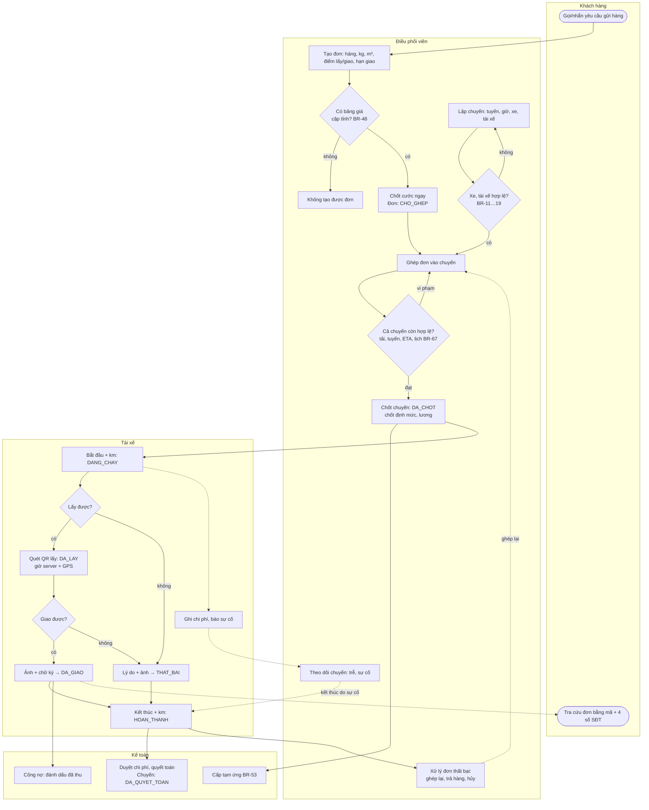
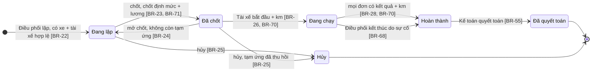
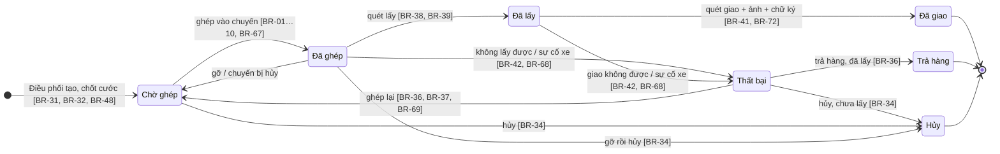
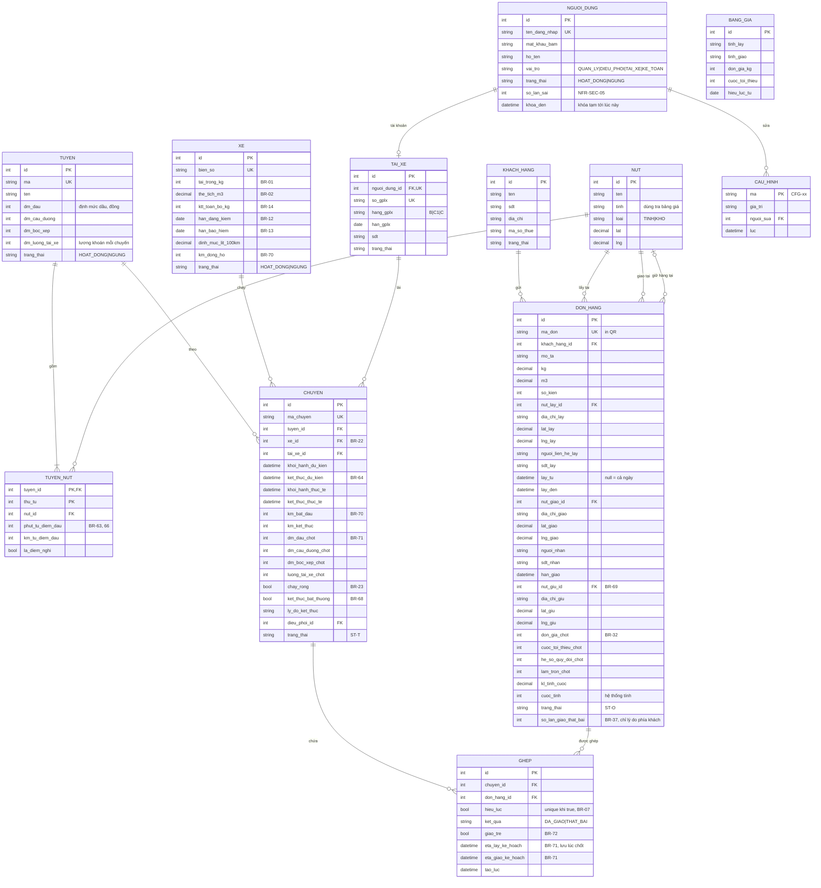
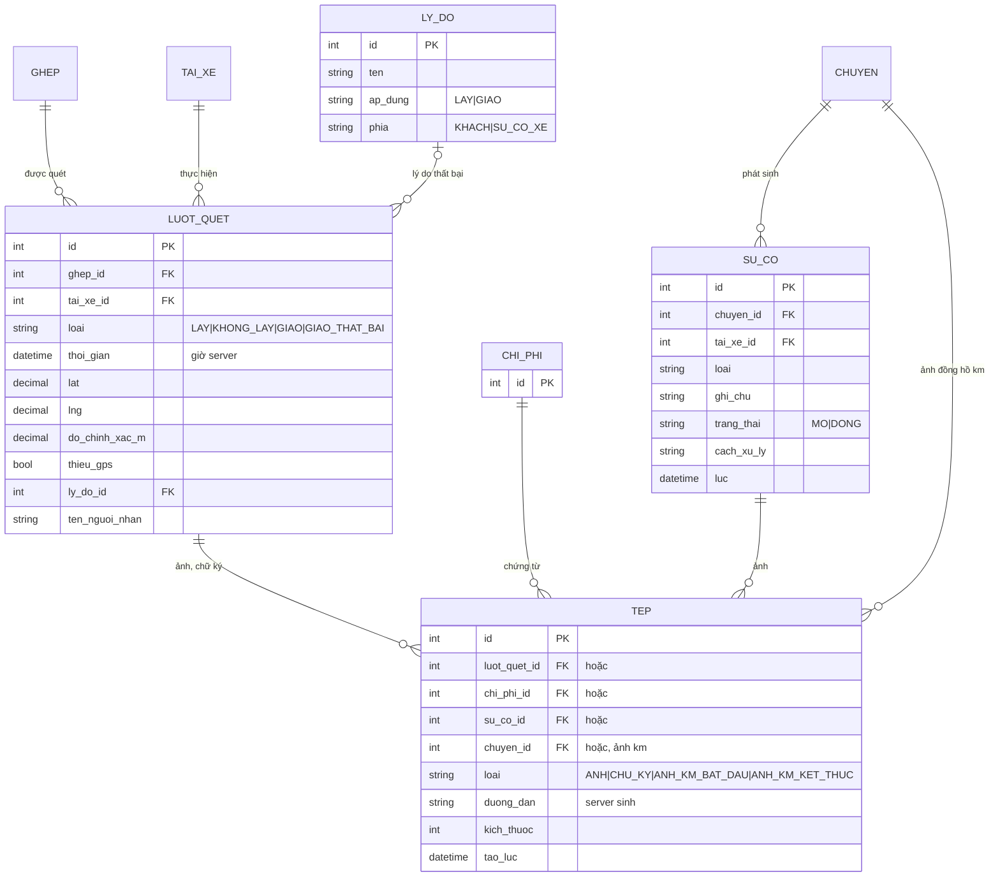
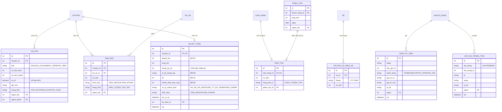
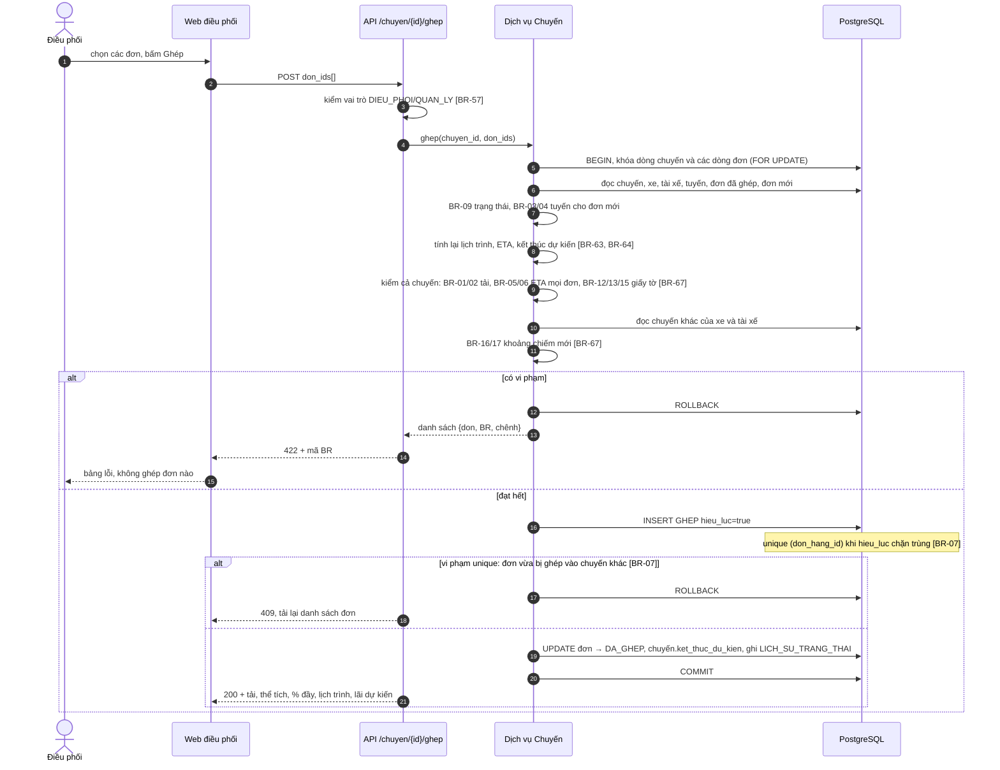
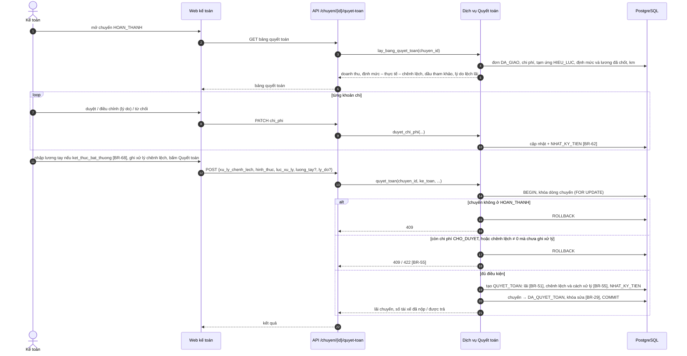

# Sơ đồ nghiệp vụ và dữ liệu

> Phiên bản 0.5 · 15/10/2026 · Nhóm 10 (Kiệt đề xuất, chờ Tài review). Khớp `docs/nghiep-vu.md` (BR-01…73) và `docs/use-cases.md` (UC-01…34).
> Viết bằng Mermaid: GitHub và VS Code (extension Markdown Preview Mermaid) hiển thị trực tiếp. Sửa nghiệp vụ thì sửa sơ đồ trong cùng commit.
> ERD là bản logic để hiểu nghiệp vụ; kiểu dữ liệu và index chi tiết chốt ở bước thiết kế CSDL.

## 1. Bức tranh nghiệp vụ

Liên quan: BR-01…73

Một vòng đời đầy đủ: đơn đi vào, được ghép lên chuyến, chạy, giao, rồi tiền được quyết toán. Mỗi làn là một tác nhân.

- Đọc từ trên xuống. Mũi tên chéo giữa các làn là lúc việc chuyển từ người này sang người khác.
- Ô thoi là chỗ hệ thống kiểm quy tắc nghiệp vụ; nhánh sai là thao tác bị chặn.
- Đơn thất bại không chết: nó quay về hàng chờ ghép (BR-69), hoặc trả hàng/hủy (BR-36).



## 2. Sơ đồ use case

Liên quan: UC-01…34

Ai làm được gì. Use case gom theo phân hệ, khớp cột Phân hệ trong bảng mục 2 của use-cases.md. UC-09, 14, 29, 31 đã bỏ ở 0.5 nên không vẽ.

- Mermaid không có ký hiệu use case chuẩn UML; báo cáo nên vẽ lại bằng draw.io hoặc StarUML theo đúng sơ đồ này.
- UC-01 Đăng nhập dùng chung cho mọi tác nhân trừ Khách, nên không vẽ đường để đỡ rối.
- UC-30 là module phụ, nét đứt: chỉ gợi ý, không quyết định.
- Quản lý làm được mọi việc của Điều phối (ma trận phân quyền mục 6 của nghiep-vu.md). Khi vẽ lại bằng UML, dùng quan hệ tổng quát hóa Quản lý → Điều phối thay vì nối lại từng use case.

```mermaid
flowchart LR
  QL(("Quản lý"))
  DP(("Điều phối viên"))
  TX(("Tài xế"))
  KT(("Kế toán"))
  KH(("Khách hàng"))
  HT(("Hệ thống<br/>hằng ngày"))
  subgraph CHUNG["Chung"]
    UC02(["UC-02 Người dùng, vai trò"])
  end
  subgraph XTX["Xe / Tài xế"]
    UC03(["UC-03 Quản lý xe"])
    UC04(["UC-04 Quản lý tài xế"])
    UC27(["UC-27 Bảng cảnh báo"])
  end
  subgraph DON["Đơn"]
    UC06(["UC-06 Khách hàng"])
    UC07(["UC-07 Bảng giá, cấu hình"])
    UC08(["UC-08 Tạo đơn, chốt cước"])
    UC10(["UC-10 Sửa / hủy đơn"])
    UC22(["UC-22 Xử lý đơn thất bại"])
  end
  subgraph CHUYEN["Chuyến"]
    UC05(["UC-05 Quản lý tuyến"])
    UC11(["UC-11 Lập chuyến"])
    UC12(["UC-12 Đổi xe, tài xế"])
    UC13(["UC-13 Ghép / gỡ đơn"])
    UC15(["UC-15 Chốt / mở chốt"])
    UC16(["UC-16 Hủy chuyến"])
    UC32(["UC-32 Theo dõi chuyến"])
  end
  subgraph QUET["Quét mã"]
    UC17(["UC-17 Xem chuyến của tôi"])
    UC18(["UC-18 Bắt đầu / kết thúc"])
    UC19(["UC-19 Quét lấy hàng"])
    UC20(["UC-20 Quét giao hàng"])
    UC33(["UC-33 Báo sự cố"])
  end
  subgraph TIEN["Quyết toán"]
    UC21(["UC-21 Ghi chi phí"])
    UC23(["UC-23 Tạm ứng"])
    UC24(["UC-24 Quyết toán chuyến"])
    UC25(["UC-25 Công nợ"])
    UC26(["UC-26 Báo cáo lãi lỗ"])
    UC34(["UC-34 Hiệu suất xe"])
  end
  subgraph TRA["Tra cứu"]
    UC28(["UC-28 Tra cứu đơn"])
  end
  subgraph PHU["Phụ trợ"]
    UC30(["UC-30 Dự đoán trễ"])
  end
  QL --- UC02 & UC07 & UC26 & UC34
  DP --- UC03 & UC04 & UC05 & UC06 & UC08 & UC10 & UC11 & UC12 & UC13 & UC15 & UC16 & UC22 & UC27 & UC32
  DP -.- UC30
  TX --- UC17 & UC18 & UC19 & UC20 & UC21 & UC33
  KT --- UC23 & UC24 & UC25 & UC26 & UC03
  KH --- UC28
  HT --- UC27
```



## 3. Trạng thái Chuyến

Liên quan: BR-22…29, 68, 70

Sáu trạng thái của một chuyến. Mỗi mũi tên ghi ai bấm và quy tắc phải thỏa.

- Lập chuyến bắt buộc có xe và tài xế ngay (BR-22), nên không còn bước "lên kế hoạch" riêng.
- Chỉ mở chốt được khi không còn tạm ứng hiệu lực (BR-24): Kế toán thu hồi trước.
- Sau DANG_CHAY không hủy được nữa: hàng đã lên xe. Chuyến kết thúc khi mọi đơn có kết quả (BR-28), hoặc Điều phối kết thúc do sự cố (BR-68).



## 4. Trạng thái Đơn

Liên quan: BR-31…45, 69, 72

Vòng đời vận hành của một đơn. Thanh toán (công nợ) là trường riêng, không nằm trong sơ đồ này.

- Ba trạng thái kết thúc thật: DA_GIAO, TRA_HANG, HUY.
- THAT_BAI là kết thúc trong một chuyến, nhưng đơn vẫn sống. Đã có lượt quét lấy (hàng trong tay công ty) → ghép lại hoặc trả hàng; chưa lấy → ghép lại hoặc hủy (BR-36).
- Hủy chỉ được khi hàng chưa lên xe (BR-34).



## 5. ERD: vận hành lõi

Liên quan: BR-01…19, 63…71

Phần trung tâm của đề tài. CHUYEN ở giữa; DON_HANG nối vào CHUYEN qua bảng GHEP chứ không trỏ thẳng.

- Vì sao có GHEP: một đơn thất bại có thể đi nhiều chuyến. GHEP giữ lịch sử, cờ hieu_luc cho biết lần ghép hiện tại. Unique index một phần (don_hang_id) WHERE hieu_luc = true thực thi BR-07 ngay trong CSDL.
- Không có bảng điểm dừng: lịch trình và ETA tính từ TUYEN_NUT và danh sách GHEP hiệu lực theo BR-63, 64.
- XE lưu hai số khối lượng: tai_trong_kg để kiểm ghép (BR-01), ktt_toan_bo_kg để kiểm hạng bằng lái (BR-14).
- Các cột _chot của DON_HANG (đơn giá, cước tối thiểu, hệ số quy đổi, bước làm tròn) là bản sao lúc tạo đơn cho BR-32; BR-33 tính lại cước chỉ từ các cột này.
- Các cột _chot của CHUYEN là định mức và lương chép từ TUYEN lúc chốt (BR-71).
- GHEP.eta_lay_ke_hoach, eta_giao_ke_hoach: ETA kế hoạch lưu lúc chốt (BR-71); độ trễ = giờ quét − ETA kế hoạch (BR-73), cũng là dữ liệu cho AI (UC-30).
- nut_giu_id, dia_chi_giu: nơi giữ hàng khi ghép lại đơn đã lấy (BR-69); khi có, thay điểm lấy trong BR-03, 04, 63.
- lat/lng điểm lấy, điểm giao vẫn giữ (Điều phối chấm trên bản đồ) dù BR-44 đã bỏ, để làm lại cảnh báo vị trí sau này.



## 6. ERD: quét mã, bằng chứng, sự cố

Liên quan: BR-38…45, 68, 70

Mỗi lần tài xế quét tạo một LUOT_QUET gắn vào lần ghép hiện tại. Ảnh, chữ ký, ảnh đồng hồ km lưu thành TEP.

- thoi_gian lấy từ server, không nhận từ điện thoại.
- Cờ thieu_gps là cảnh báo cho Điều phối, không chặn thao tác (BR-43).
- loai của LUOT_QUET vẫn phân biệt KHONG_LAY và GIAO_THAT_BAI (để biết đã lấy hàng chưa), dù trạng thái đơn đều về THAT_BAI.
- LY_DO.phia cho BR-37 biết lần thất bại có tính vào CFG-04 không.
- TEP dùng chung: đúng một trong bốn khóa ngoại có giá trị. Tên file do server sinh.



## 7. ERD: tiền

Liên quan: BR-46…62, 68, 71

Mọi khoản tiền đều gắn vào CHUYEN, DON_HANG hoặc XE. Tiền lưu số nguyên đồng.

- Cước của đơn là DON_HANG.cuoc_tinh, không có điều chỉnh tay (BR-61 bỏ).
- PHAI_THU sinh khi đơn DA_GIAO; Kế toán đánh dấu đã thu cho một hoặc nhiều khoản (BR-56). PHIEU_THU rút gọn: một lần đánh dấu đã thu.
- QUYET_TOAN một-một với CHUYEN; tạo ra là khóa sổ (BR-29). Lưu cách xử lý chênh lệch tạm ứng (BR-55).
- Mở chốt hoặc hủy chuyến đã cấp tạm ứng: Kế toán ghi các khoản HIEU_LUC sang DA_THU_HOI trước, có ghi NHAT_KY_TIEN (BR-24, 25).
- CHI_PHI_CO_DINH_XE dùng cho lãi theo xe theo tháng (UC-26, 34), không vào lãi chuyến.
- NHAT_KY_TIEN và LICH_SU_TRANG_THAI chỉ thêm, không sửa xóa (BR-62, BR-30).



## 8. Sequence: ghép đơn vào chuyến (UC-13)

Liên quan: BR-01…09, 63, 64, 67

Luồng quan trọng nhất của đề tài. Kiểm cả lô và cả chuyến trong một giao dịch: một đơn sai thì không ghép đơn nào.

- Khóa dòng chuyến và các dòng đơn (SELECT … FOR UPDATE) để hai người ghép cùng lúc không làm vượt tải hay ghép trùng một đơn.
- Thêm đơn làm thêm điểm dừng, nên ETA các đơn đã ghép dịch đi và chuyến dài ra: phải kiểm lại cả chuyến (BR-67), không chỉ đơn mới.
- Lỗi trả về danh sách mã BR bị vi phạm để giao diện hiện cho Điều phối (NFR-USA-02).



## 9. Sequence: tài xế quét giao (UC-20)

Liên quan: BR-38…45, 72

Điện thoại chỉ gửi mã đơn, tọa độ và ảnh. Giờ quét, quyền và trạng thái đều do server quyết.

- Đơn không thuộc chuyến của tài xế đang đăng nhập → 403, chống IDOR. Chuyến của mình nhưng sai trạng thái → 409.
- Khóa chuyến trước, đơn sau (thứ tự khóa ở `kien-truc.md` mục 6), để tài xế không kết thúc chuyến khi một lượt quét đang chạy.
- Giao thành công sinh khoản phải thu ngay trong cùng giao dịch. Giao sau hạn vẫn cho giao, gắn cờ giao trễ.

```mermaid
sequenceDiagram
  autonumber
  actor TX as Tài xế
  participant APP as Web tài xế (điện thoại)
  participant API as API /api/toi/quet
  participant SV as Dịch vụ Quét
  participant DB as PostgreSQL
  TX->>APP: quét QR tại điểm GIAO
  APP->>APP: lấy GPS (có thể bị từ chối)
  TX->>APP: chụp ảnh, nhập tên, người nhận ký
  APP->>API: POST ma_don, loai=GIAO, lat/lng?, ảnh, chữ ký
  API->>SV: quet(tai_xe hiện tại, ...)
  SV->>DB: BEGIN, tìm GHEP hiệu lực của đơn
  SV->>DB: khóa dòng chuyến (FOR SHARE) rồi dòng đơn (FOR UPDATE)
  alt không thuộc chuyến của tài xế
    SV-->>API: 403 [BR-38]
  else chuyến của mình nhưng không ở DANG_CHAY
    SV-->>API: 409 [BR-38]
  else đơn đã có kết quả (DA_GIAO hoặc THAT_BAI)
    SV-->>API: 200 kèm trạng thái hiện tại [BR-45]
  else đơn đang DA_GHEP
    SV-->>API: 409 "đơn chưa được quét lấy" [BR-40]
  else hợp lệ
    SV->>SV: kiểm loại và kích thước file ảnh, chữ ký (security-rules)
    SV->>SV: kiểm ảnh + chữ ký + tên [BR-41]
    SV->>SV: giờ server; thiếu GPS thì gắn cờ [BR-43]; quá hạn giao thì giao_tre [BR-72]
    SV->>DB: lưu TEP (tên file server sinh), LUOT_QUET
    SV->>DB: đơn → DA_GIAO, GHEP.ket_qua, giao_tre, LICH_SU_TRANG_THAI
    SV->>DB: tạo PHAI_THU = cước, CHUA_THU [BR-56], NHAT_KY_TIEN
    API-->>APP: 200 Đã giao
  end
```

## 10. Sequence: quyết toán chuyến (UC-24)

Liên quan: BR-50…55, 62, 68

Kế toán chốt sổ một chuyến đã hoàn thành.

- Doanh thu chỉ tính đơn giao thành công trên chuyến này (BR-50).
- Lương lấy từ số đã chốt vào chuyến (BR-71); chuyến kết thúc do sự cố thì Kế toán nhập tay kèm lý do (BR-68).
- Chênh lệch dương: tài xế nộp lại; âm: công ty trả thêm. Khác 0 thì phải ghi đã xử lý (BR-55).


